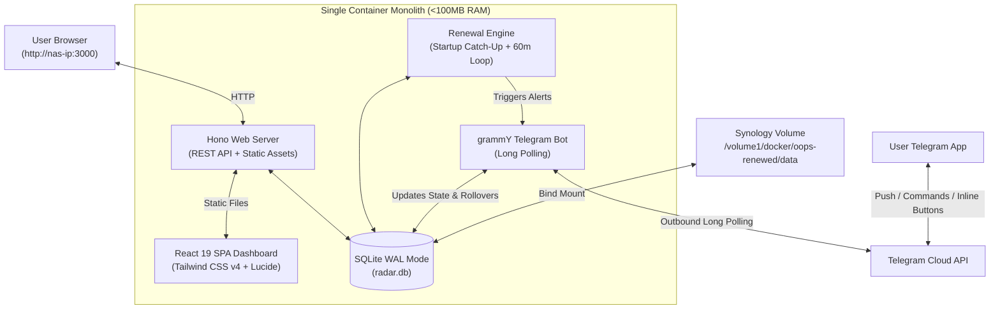

# 📡 Oops, Renewed!

**Oops, Renewed!** is a production-grade, self-hosted subscription, recurring renewal, domain expiry, and free trial tracking monolith. Engineered to run inside a single Docker container on low-power **Synology NAS** devices (e.g. DS220+, DS720+, DS920+, DS423+), it consumes less than **100MB of RAM** and includes an **offline-resilient scheduling engine** designed to survive overnight NAS power-offs.

---

## 📑 Table of Contents

1. [Why Oops, Renewed!?](#-why-oops-renewed)
2. [System Architecture](#-system-architecture)
   - [Monolith Process Model](#monolith-process-model)
   - [Data Flow & Catch-Up Workflow](#data-flow--catch-up-workflow)
3. [Key Features](#-key-features)
4. [Synology NAS Installation Guide](#-synology-nas-installation-guide)
   - [Method 1: Synology Container Manager (GUI)](#method-1-synology-container-manager-gui)
   - [Method 2: Docker Compose via SSH](#method-2-docker-compose-via-ssh)
5. [Telegram Bot Setup & Commands](#-telegram-bot-setup--commands)
6. [Web Dashboard Walkthrough](#-web-dashboard-walkthrough)
7. [Environment Variables Reference](#-environment-variables-reference)
8. [Database, Backups & Migrations](#-database-backups--migrations)
9. [Development & Testing](#-development--testing)

---

## 💡 Why Oops, Renewed!?

Most subscription managers either require third-party SaaS cloud accounts (leaking your financial subscriptions and renewal dates) or rely on rigid minute-based cron jobs that miss alerts when a home NAS is scheduled to shut down overnight to save electricity.

Oops, Renewed! solves this with:

- **Zero Cloud Dependence:** Stores everything in a local, transactional SQLite database with WAL mode enabled.
- **Offline Resilience:** Persists alert state. When your Synology NAS powers on in the morning, the container immediately performs a catch-up audit, advancing overdue cycles and firing any missed Telegram reminders.
- **True Normalized Financial Run Rate:** Normalizes annual, quarterly, and custom intervals into an accurate 30-day burn rate across currencies (PLN, EUR, USD, GBP, CHF).
- **Interactive Action Buttons:** Manage, roll over, snooze, or cancel renewals directly from your Telegram notifications.

---

## 🏛️ System Architecture

### Monolith Process Model

Oops, Renewed! runs as a **single Node.js 22 (Alpine) process** containing:

1. **Hono Web Server & REST API:** High-throughput, lightweight HTTP server serving both the JSON API and the pre-built React 19 SPA.
2. **SQLite WAL Database:** Direct embedded access via `better-sqlite3` mounted to `/app/data/radar.db`.
3. **Offline-Resilient Scheduler:** Startup auditor and 60-minute interval loop.
4. **grammY Telegram Engine:** Inbound and outbound communications via long polling (no open ports or reverse proxy required).



### Data Flow & Catch-Up Workflow

When your NAS boots up or the container restarts:

```mermaid
sequenceDiagram
    autonumber
    participant Docker as Container Entrypoint
    participant DB as SQLite (WAL)
    participant Engine as Renewal Engine
    participant Bot as grammY Bot
    participant TG as Telegram User

    Docker->>DB: Open radar.db & apply migrations (WAL Mode)
    Docker->>Bot: Start Long-Polling (verify ALLOWED_TELEGRAM_CHAT_ID)
    Docker->>Engine: Run immediate startup audit

    rect rgb(20, 30, 45)
        Note over Engine,DB: Auto-Rollover Step
        Engine->>DB: Query non-trials where next_renewal_date < today
        Engine->>DB: Advance dates past today by cycle; reset reminded flag
    end

    rect rgb(20, 30, 45)
        Note over Engine,TG: Alert Dispatch Step
        Engine->>DB: Query items within remind_days_before without cycle alert
        Engine->>Bot: Build formatted MarkdownV2 alert with action buttons
        Bot->>TG: Send rich push alert
        Engine->>DB: Transactionally record last_reminded_for_cycle_date = renewal_date
    end

    Note over Docker: Start 60-minute periodic interval
```

---

## ⚡ Key Features

- **True Monthly Burn Rate Calculation:**
  $$
  \text{Normalized Monthly} = \begin{cases}
  \text{amount} & \text{if monthly} \\
  \text{amount} / 3 & \text{if quarterly} \\
  \text{amount} / 12 & \text{if yearly} \\
  \text{amount} \times (30.4375 / \text{days}) & \text{if custom days}
  \end{cases}
  $$
- **Color-Coded Urgency Badges:**
  - 🔴 **Critical:** $\le 3$ days remaining or active Free Trial ending.
  - 🟡 **Warning:** $\le 7$ days remaining.
  - 🟢 **Calm:** $> 7$ days remaining.
- **One-Click Row Testing:** Test your Telegram webhook and alert layout with an inline "Test Alert" button on every subscription row.
- **Direct Cancellation Links:** Store direct URLs (`cancel_url`) to account billing portals.
- **Graceful Shutdown Protection:** Captures `SIGTERM` / `SIGINT` from Docker/DSM, closes the polling lOops, and runs `PRAGMA wal_checkpoint(TRUNCATE)` before process exit.

---

## 🚀 Synology NAS Installation Guide

### Method 1: Synology Container Manager (GUI)

_Recommended for Synology DSM 7.2+._

1. **Create the Storage Directory:**
   - Open **File Station** in DSM.
   - Navigate to the `docker` shared folder (e.g., `/volume1/docker/`).
   - Create a new folder named `oops-renewed`, and inside it create a `data` folder:
     `/volume1/docker/oops-renewed/data`
2. **Open Container Manager:**
   - Launch **Container Manager** from the DSM main menu.
   - Go to **Project** on the left sidebar and click **Create**.
3. **Configure the Project:**
   - **Project Name:** `oops-renewed`
   - **Path:** Browse to `/docker/oops-renewed`
   - **Source:** Select _Create docker-compose.yaml_ and paste the following:

```yaml
version: '3.8'

services:
  oops-renewed:
    image: oops-renewed:latest
    build:
      context: https://github.com/your-username/renewalRadar.git#main
      dockerfile: Dockerfile
    container_name: oops-renewed
    restart: unless-stopped
    ports:
      - '3000:3000'
    environment:
      - PORT=3000
      - DEFAULT_CURRENCY=PLN
      - TZ=Europe/Warsaw
      - TELEGRAM_BOT_TOKEN=YOUR_BOT_TOKEN_HERE
      - ALLOWED_TELEGRAM_CHAT_ID=YOUR_CHAT_ID_HERE
      - DB_PATH=/app/data/radar.db
    volumes:
      - /volume1/docker/oops-renewed/data:/app/data
    deploy:
      resources:
        limits:
          memory: 150M
        reservations:
          memory: 40M
```

4. **Deploy:**
   - Click **Next**, complete the wizard, and click **Done**. Container Manager will build the lightweight image and launch it.
   - Open your browser and navigate to: `http://<SYNOLOGY_IP>:3000`.

---

### Method 2: Docker Compose via SSH

1. **SSH into your Synology NAS:**
   ```bash
   ssh your_admin_user@your-nas-ip
   ```
2. **Clone the repository and set up directories:**
   ```bash
   sudo mkdir -p /volume1/docker/oops-renewed/data
   cd /volume1/docker/oops-renewed
   git clone https://github.com/your-username/renewalRadar.git .
   ```
3. **Configure Environment Variables:**
   ```bash
   cp .env.example .env
   nano .env
   ```
   Set your `TELEGRAM_BOT_TOKEN`, `ALLOWED_TELEGRAM_CHAT_ID`, and `TZ`.
4. **Build and Launch Container:**
   ```bash
   sudo docker compose up -d --build
   ```
5. **View Real-Time Logs:**
   ```bash
   sudo docker compose logs -f
   ```

---

## 🤖 Telegram Bot Setup & Commands

### How to Get Your Telegram Credentials

1. **Create Bot Token:**
   - Message [`@BotFather`](https://t.me/BotFather) on Telegram.
   - Send `/newbot`, provide a name and username (e.g., `MyOopRenewedBot`).
   - Copy the HTTP API token provided (e.g. `789123456:AAFl1...`).
2. **Retrieve Your Private Chat ID:**
   - Message [`@userinfobot`](https://t.me/userinfobot) or [`@raw_data_bot`](https://t.me/raw_data_bot).
   - Copy the numerical ID (e.g., `123456789`).
   - Place this into `ALLOWED_TELEGRAM_CHAT_ID`. Anyone else who tries to message your bot will be rejected by the authentication guard.

### Bot Commands

| Command                                     | Description                                                                       | Example                              |
| :------------------------------------------ | :-------------------------------------------------------------------------------- | :----------------------------------- |
| `/start` or `/summary`                      | Shows monthly burn rate, annual spend, active counts, and top 3 upcoming renewals | `/summary`                           |
| `/upcoming`                                 | Lists all renewals scheduled in the next 30 days                                  | `/upcoming`                          |
| `/add <Name> <Amount> <Cycle> <YYYY-MM-DD>` | Quickly record a new subscription from chat                                       | `/add Mullvad 25 monthly 2026-11-15` |
| `/help`                                     | Explains command syntax and interactive alert capabilities                        | `/help`                              |

### Interactive Alert Buttons

When an alert is sent, it includes 3 inline action buttons:

- **`✅ Roll to Next Cycle`:** Advances `next_renewal_date` by 1 cycle in SQLite and updates the message.
- **`⏰ Remind Tomorrow`:** Sets a 24-hour snooze flag; reminders resume the next day.
- **`🛑 Mark Cancelled`:** Sets `active = 0`, archiving the subscription and suppressing future alerts.

---

## 🖥️ Web Dashboard Walkthrough

- **KPI Header:**
  - **Monthly Burn Rate:** Sum of all active items normalized to a 30-day rate.
  - **Annual Projection:** 12-month spend forecast.
  - **Due This Month:** Remaining cash outflow for the current calendar month.
  - **Active Free Trials:** Highlights trials so you cancel before credit card charges hit.
- **Timeline Table:**
  - Sort by Renewal Date, Amount, or Name.
  - Filter by Category (Entertainment, Infrastructure, Utilities, Insurance, Trial, Other).
  - Search by Name or Notes.
  - Action buttons: Test Alert (🔔), Roll Cycle (🔄), Edit (✏️), Archive/Restore (📦), Delete (🗑️).

---

## ⚙️ Environment Variables Reference

| Variable                   | Default              | Required?   | Description                                                             |
| :------------------------- | :------------------- | :---------- | :---------------------------------------------------------------------- |
| `PORT`                     | `3000`               | No          | Internal port for the Hono HTTP server                                  |
| `DEFAULT_CURRENCY`         | `PLN`                | No          | Default currency for KPI summaries (`PLN`, `EUR`, `USD`, `GBP`, `CHF`)  |
| `TZ`                       | `Europe/Warsaw`      | Recommended | Host timezone so midnight renewals match your local calendar            |
| `TELEGRAM_BOT_TOKEN`       | _(empty)_            | Optional    | Bot token from `@BotFather`. If omitted, bot is safely disabled         |
| `ALLOWED_TELEGRAM_CHAT_ID` | _(empty)_            | Recommended | Restricts bot commands and push alerts to your private Telegram user ID |
| `DB_PATH`                  | `/app/data/radar.db` | No          | Path to SQLite file inside container                                    |

---

## 💾 Database, Backups & Migrations

- **Database Location:** All data is stored in a single file at `/volume1/docker/oops-renewed/data/radar.db`.
- **WAL Mode:** Write-Ahead Logging (`radar.db-wal` and `radar.db-shm`) ensures high performance and prevents table locking during concurrent reads.
- **Backups:** Because the database is self-contained, you can back it up using Synology **Hyper Backup** or a simple cron copy:
  ```bash
  # Safe live backup using SQLite CLI:
  sqlite3 /volume1/docker/oops-renewed/data/radar.db ".backup '/volume1/backup/radar-backup-$(date +%F).db'"
  ```

---

## 🧪 Development & Testing

### Local Setup

```bash
# 1. Install dependencies
npm install

# 2. Run test suite (40 unit tests)
npm test

# 3. Build client & server
npm run build

# 4. Start local development server with hot-reload
npm run dev
```

### Test Suite Coverage

The project includes 40 unit tests across 12 suites covering:

- Date parsing, end-of-month clamping (e.g. Jan 31 $\rightarrow$ Feb 28), and annualization.
- Past-date auto-rollover algorithms.
- SQLite schema migrations, constraints, and KPI calculations.
- Telegram MarkdownV2 escaping and inline keyboard generation.
- Alert deduplication and snooze logic.

---

## 📄 License

MIT License. Built for self-hosters and Synology NAS homelabs.
